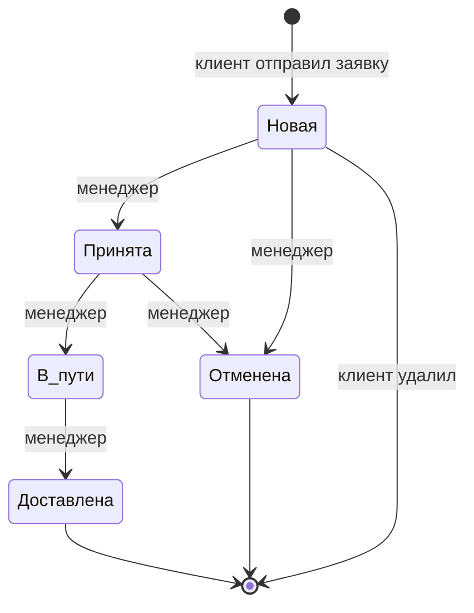
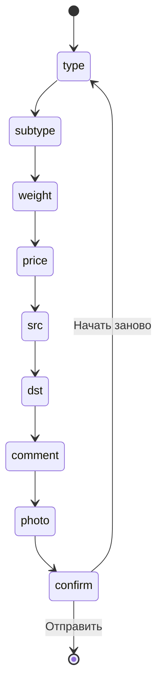
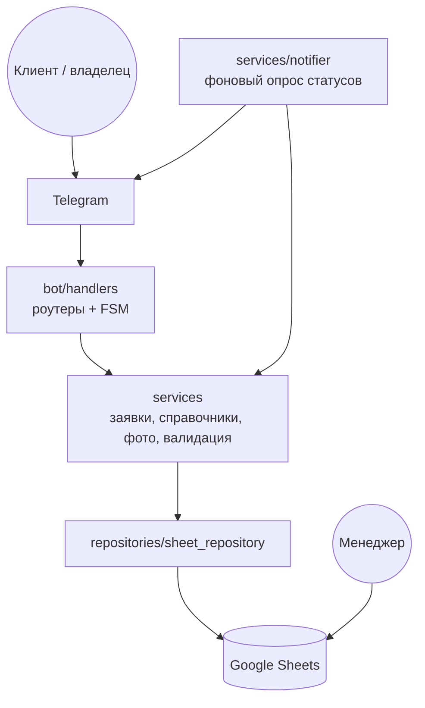

# SheetHappens

Telegram-бот приёма заявок на доставку с Google-таблицей в качестве CRM:
клиент оформляет заявку пошагово, менеджер ведёт её прямо в таблице, бот присылает клиенту смену статуса.


## Возможности

### Клиент
- **Новая заявка** — пошаговый FSM-диалог: тип → подтип → вес → объявленная стоимость → откуда → куда → комментарий → фото → подтверждение
- Типы и подтипы берутся из листа «Справочники» (кэш с TTL, `DICTS_TTL`)
- Кнопки «Назад», «Пропустить», «Отмена», «Начать заново» на каждом шаге
- Валидация веса, стоимости, телефона и длины текста
- **Мои заявки** — последние заявки клиента со статусами
- **Дополнить заявку** — телефон получателя или комментарий (только в статусах «Новая» / «Принята»)
- **Удалить последнюю заявку** — с подтверждением, только в статусе «Новая»
- Уведомление клиенту, когда менеджер меняет статус в таблице (опрос раз в `NOTIFY_INTERVAL` секунд)

### Владелец (owner)
| Команда / кнопка | Что делает |
|---|---|
| `/owner` | Открыть панель владельца |
| 📊 Статистика | Всего заявок, клиентов, разбивка по статусам |
| 🗂 Последние заявки | Последние `OWNER_ORDERS_LIMIT` заявок всех клиентов |
| ♻️ Обновить справочники | Сбросить кэш и перечитать «Справочники» |
| 🩺 Проверить таблицу | Пинг Google Sheets с временем ответа |
| `/owner_off` | Временно выключить owner-режим (видеть бота как обычный клиент) |
| `/owner_on` | Включить owner-режим обратно |

Владелец определяется по username из `OWNER_USERNAME`. Полностью отключить owner-функции (например, для тестов) — `OWNER_ENABLED=false`.

## Жизненный цикл заявки



## FSM оформления заявки



## Архитектура



Слои зависят только сверху вниз: хендлеры не знают о таблице, репозиторий не знает о Telegram.

## Структура таблицы

| Лист | Колонки |
|---|---|
| Заявки | ID заявки, Создана, Telegram, Telegram ID, Тип, Подтип, Вес кг, Объявл. стоимость ₽, Откуда, Куда, Комментарий, Фото, Телефон получателя, Статус, Комментарий менеджера |
| Справочники | Тип, Подтип, (пусто), Статус |
| Журнал | Время, Telegram ID, Действие, ID заявки |

ID заявок — `D-000001`, `D-000002`, …

## Стек

| Слой | Технология |
|---|---|
| Бот | Python 3.12, aiogram 3 (Router, FSM, MemoryStorage) |
| Хранилище | Google Sheets через gspread (сервисный аккаунт) |
| Конфиг | python-dotenv |
| Деплой | Docker, docker compose |

## Запуск

### 1. Google-таблица
1. Создайте сервисный аккаунт в Google Cloud, включите Google Sheets API, скачайте ключ в `credits.json`.
2. Создайте таблицу и дайте сервисному аккаунту права редактора.
3. Разметьте листы и заполните справочники:

```bash
python scripts/setup_sheet.py
```

### 2. Переменные окружения

Скопируйте `.env.example` в `.env`:

| Переменная | Описание |
|---|---|
| `BOT_TOKEN` | Токен бота от @BotFather |
| `SPREADSHEET_ID` | ID Google-таблицы |
| `GOOGLE_CREDENTIALS` | Путь к ключу сервисного аккаунта (по умолчанию `credits.json`) |
| `OWNER_USERNAME` | Username владельца без `@` |
| `OWNER_ENABLED` | `true` / `false` — включить owner-функции |
| `PHOTO_CHAT_ID` | Чат для хранения фото (опционально) |
| `DATA_DIR` | Каталог для рантайм-данных (по умолчанию `data`) |
| `DICTS_TTL` | TTL кэша справочников, сек (300) |
| `NOTIFY_INTERVAL` | Период опроса статусов, сек (60) |
| `PROXY_URL` | Прокси для Telegram API (опционально, `socks5://…`) |
| `LOG_LEVEL` | Уровень логов (`INFO`) |

### 3. Запуск локально

```bash
pip install -r requirements.txt
python -m app.main
```

### 3'. Запуск в Docker

```bash
docker compose up -d --build
```

Проверить доступ к таблице без бота:

```bash
python scripts/check_repository.py
```

## Структура проекта

```
app/
├── main.py                     # точка входа, сборка зависимостей
├── config.py                   # .env, имена листов и колонок, константы
├── texts.py                    # все тексты и подписи кнопок
├── bot/
│   ├── states.py               # FSM: NewOrder, EditOrder, DeleteOrder
│   ├── keyboards.py            # reply-клавиатуры
│   ├── filters.py              # IsOwner, OwnerMode
│   ├── formatting.py           # форматирование заявок
│   └── handlers/
│       ├── menu.py             # /start, главное меню
│       ├── new_order.py        # оформление заявки
│       ├── my_orders.py        # список заявок клиента
│       ├── edit_order.py       # дополнение заявки
│       ├── delete_order.py     # удаление последней заявки
│       ├── owner.py            # панель владельца
│       ├── fallback.py         # непонятные сообщения
│       └── errors.py           # глобальный обработчик ошибок
├── services/
│   ├── orders.py               # бизнес-логика заявок
│   ├── dictionaries.py         # справочники с кэшем
│   ├── validation.py           # проверка ввода
│   ├── photos.py               # хранение фото
│   └── notifier.py             # уведомления о смене статуса
└── repositories/
    └── sheet_repository.py     # доступ к Google Sheets с ретраями
scripts/
├── setup_sheet.py              # разметка таблицы
└── check_repository.py         # smoke-проверка репозитория
docs/
└── technical-specification.docx
```

## Безопасность

- Токен бота и ключ сервисного аккаунта — только в `.env` / `credits.json`, оба в `.gitignore`
- Клиент видит и меняет только свои заявки (проверка по Telegram ID)
- Owner-функции доступны только по username из конфига и отключаются флагом
- Ретраи с backoff на 429/5xx от Google API

## Известные ограничения

- **Запускать только один экземпляр бота.** ID заявок выдаются из счётчика в памяти процесса (при старте он читается с листа «Журнал»). Два процесса с одной таблицей выдадут одинаковые ID.
- **Правка таблицы во время операции бота.** В Google Sheets нет транзакций. Если менеджер удалит или вставит строку на листе «Заявки» в ту же секунду, когда бот меняет или удаляет заявку, бот может попасть не в ту строку. Строки на листе «Заявки» вручную лучше не удалять и не вставлять — для отмены есть статус «Отменена».
- **Лист «Журнал» не очищать.** По нему восстанавливается счётчик ID; без него номера удалённых заявок начнут выдаваться повторно.
- **FSM в памяти.** `MemoryStorage` — при перезапуске недооформленные заявки теряются.
